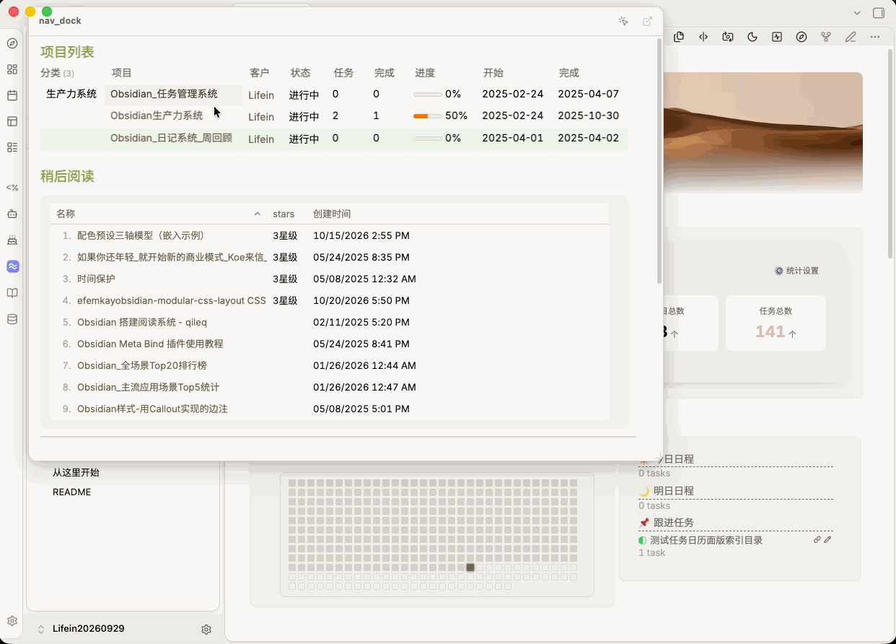

# Nav Dock

[English](./README.md) | [中文](./README_ZH.md)

[](https://obsidian.md/plugins?id=nav-dock)  [](https://github.com/ichris007/nav-dock/stargazers) [](https://github.com/ichris007/nav-dock/blob/main/LICENSE)

[Report a bug](https://github.com/ichris007/nav-dock/issues/new) · [Request a feature](https://github.com/ichris007/nav-dock/issues/new)

> Keep your navigation pages, quick-reference guides, and frequently used notes right beside the Obsidian Ribbon. Hover over or click the icon to view them in a pop-up panel—without taking up another tab.

Nav Dock opens a pop-up panel beside a Ribbon icon and displays a Markdown document of your choice. The panel follows Obsidian's Markdown preview styling and supports common content such as wikilinks, embeds, callouts, and tables. You can also edit the document directly in the panel.



## Highlights

- **A navigation panel that's always at hand:** Keep navigation pages, frequently used links, and quick-reference guides close by without switching tabs.
- **Native Markdown rendering:** Uses Obsidian's preview styling, keeping fonts, line height, headings, blockquotes, callouts, tables, embedded content, and Dataview results consistent with the main note view.
- **Hover or click to open:** Hover mode is ideal for quick access; click mode helps prevent accidental opening and closing. Switch between the two at any time.
- **Multiple ways to open:** Use the Ribbon icon, Command Palette, keyboard shortcuts, or an `obsidian://` URI.
- **Smart link handling:** Activates a note that's already open in the workspace instead of creating a duplicate tab. Hold `Ctrl` / `Cmd` while clicking to force a new tab.
- **Wikilink hover previews:** Hover over a `[[wikilink]]` in the panel to preview the linked note without holding `Cmd`.
- **Edit in place:** Click the body to start editing. Changes are saved automatically; press `Esc` to exit editing.
- **Resizable panel:** Drag the panel's bottom-right corner to adjust its width and height. The size is saved and reused the next time you open it.
- **Quick navigation-note search:** Type in the settings field to filter notes by filename and folder path.
- **Built-in icon picker:** Search and choose from 1,500+ icons, with incremental loading as you scroll.
- **Bilingual interface:** Choose System, Chinese, or English. Commands, prompts, and settings update to match the selected language.
- **In-panel heading navigation:** Click a `#heading` link to scroll within the panel without navigating away or closing it.
- **Workspace-aware layout:** Supports light and dark themes, docked and floating sidebars on either side, and repositions the panel when the window is resized.

## Installation

### From the community plugin directory (recommended)

1. Open **Settings → Community plugins** and turn off Restricted mode if it is enabled.
2. Click **Browse** and search for **Nav Dock**.
3. Select it, click **Install**, then **Enable**.

### Manual installation

Use this when you need a specific version or the directory is unreachable.

1. Download the latest archive from [GitHub Releases](https://github.com/ichris007/nav-dock/releases).
2. Extract the archive and place `main.js`, `manifest.json`, and `styles.css` in your vault's `.obsidian/plugins/nav-dock/` directory.
3. Restart Obsidian, go to **Settings → Community plugins**, refresh the plugin list, and enable **Nav Dock**.

**Requirements:** Obsidian 1.5.0 or later. Desktop only.

## Quick Start

1. After enabling Nav Dock, an icon (a compass by default) appears in the left Ribbon.
2. Open **Settings → Nav Dock**.
3. In **Navigation note**, enter the name or path of the note you want to display. You can also click **Use current note** to select the currently open note.
4. Hover over the Ribbon icon to view your navigation note.

For example, create a note named `Homepage.md` and organize project links, frequently used notes, and reference material in it. Then select it as your Nav Dock navigation note.

## Usage

### Opening and closing the panel

| Mode | How to open | How to close |
| --- | --- | --- |
| **Hover** (default) | Move the pointer over the Ribbon icon | Move the pointer away from both the icon and panel; it closes after about 220 ms |
| **Click** | Click the Ribbon icon | Click the icon again, press `Esc`, or click outside the panel |

Additional details:

- Moving the pointer into the panel keeps it open, so you can read and click links without rushing.
- There is an 8 px gap between the icon and the panel. In hover mode, the roughly 220 ms closing delay helps prevent the panel from closing as you move the pointer across the gap.
- Opening the panel from the Ribbon places it next to the Ribbon.
- Opening it through a command, keyboard shortcut, or URI places it in the center of the screen with an overlay. Click the overlay to close the panel.
- Drag the panel's bottom-right corner to resize it. Manually dragging the height may override the automatic height setting; you can restore automatic sizing in Settings.

### Commands and keyboard shortcuts

Open the Command Palette with `Cmd/Ctrl + P` and search for **Nav Dock**.

| Command | Behavior |
| --- | --- |
| **Nav Dock: Toggle navigation panel (pinned; does not close when the pointer leaves)** | Opens a pinned panel in the center of the screen. It stays open when the pointer moves away. Run the command again to close it. |
| **Nav Dock: Open navigation note in a tab** | Opens the navigation note as a regular tab. If the note is already open, switches to it instead. |

To assign a keyboard shortcut, go to **Settings → Hotkeys** and search for `Nav Dock`.

### URI actions

Nav Dock supports the following URIs:

```text
obsidian://nav-dock?action=toggle
obsidian://nav-dock?action=open-in-tab
```

Add these URIs as links in your notes, or call them through Meta Bind or a button-style plugin.

| Parameter | Behavior |
| --- | --- |
| `action=toggle` | Opens or closes the navigation panel. This is the default if `action` is omitted. |
| `action=open-in-tab` | Opens the navigation note in a tab. |

### Settings reference

| Setting | Description |
| --- | --- |
| **Interface language** | Choose System, Chinese, or English. Settings, commands, and prompts update to match the selected language. |
| **Navigation note** | Select the note displayed in the panel. Type to filter files, or use **Use current note**. |
| **Opening mode** | Switch between Hover and Click. The button in the panel's title bar also changes the mode, and both controls stay in sync. |
| **Icon** | Search and choose an icon. The picker loads more icons as you scroll and highlights the current selection. |
| **Tooltip** | Set the text shown when hovering over the Ribbon icon. |
| **Panel width** | Set the width between 280 and 720 px. This stays in sync with resizing by dragging. |
| **Automatic height limit** | Set the maximum automatic height as a percentage of the viewport. If the content exceeds the limit, the panel scrolls internally. |
| **Restore automatic sizing / Reset size** | Restore automatic height, or reset both width and height to their defaults. |
| **Show title bar** | Display the filename and an **Open in tab** button at the top of the panel. |
| **Wikilink opening location** | Open links in a new tab or the current tab. `Ctrl` / `Cmd`-click always opens a new tab. |
| **Close after clicking a link** | Enabled by default. The panel closes after a regular link is clicked; in-note heading links such as `#Heading` do not close it. |
| **Editing** | No separate toggle is needed. Click the body to edit, then press `Esc` to exit. Changes are saved automatically. |

## Creating a Navigation Note

A navigation note is just a regular Markdown note. Organize it to fit your workflow. Here's a template you can copy and adapt:

```markdown
# Navigation

## Workspace
- [[Project Overview]]
- [[Weekly Report]]
- [[Task List]]

## Knowledge Base
- [[Reading Notes]]
- [[Templates/Daily Note Template|Daily Note Template]]

> [!tip] Tip
> Clicking a link in the panel navigates to the note and closes the panel according to your settings.
```

Callouts, tables, task lists, `![[embeds]]`, and rendered Dataview results are also supported.

## Customizing the Panel's Appearance

To customize the Nav Dock panel independently, override these CSS variables in an Obsidian CSS snippet. There's no need to modify the plugin files:

```css
body {
  --nav-dock-bg: var(--background-primary);
  --nav-dock-border: var(--background-modifier-border);
  --nav-dock-radius: var(--radius-l);
  --nav-dock-shadow: var(--shadow-l);
}
```

## FAQ

### The panel opens but is blank. What should I check?

Go to **Settings → Nav Dock** and make sure **Navigation note** is set. The field supports fuzzy search. You can enter a vault-relative path (for example, `Homepage`) or the full path.

### Links in the panel don't respond when clicked. Why?

Nav Dock handles internal-link clicks during the capture phase. Because the panel is mounted under `document.body`, Obsidian 1.14.4's event delegation may not receive those clicks correctly. If you encounter link issues, please report them on [GitHub Issues](https://github.com/ichris007/nav-dock/issues).

### How do I disable wikilink hover previews?

Go to **Settings → Page preview** (the core plugin settings) and disable the entry for **Nav Dock panel**.

### When using split panes, why does a new tab sometimes open in the wrong pane?

This is a known limitation. In multi-pane layouts, a new tab may open in a pane that isn't active. The plugin tries to identify the currently active pane, but Obsidian doesn't expose a public API that can reliably identify it. If this happens, please report it on [GitHub Issues](https://github.com/ichris007/nav-dock/issues).

### Does Nav Dock support mobile?

Not currently. Nav Dock is desktop-only (`isDesktopOnly`).

## Feedback and Issues

If you run into a problem, notice unexpected behavior, or have a feature request, please share it on [GitHub Issues](https://github.com/ichris007/nav-dock/issues). User feedback helps uncover issues and improve the plugin.

## License

[MIT](LICENSE)
